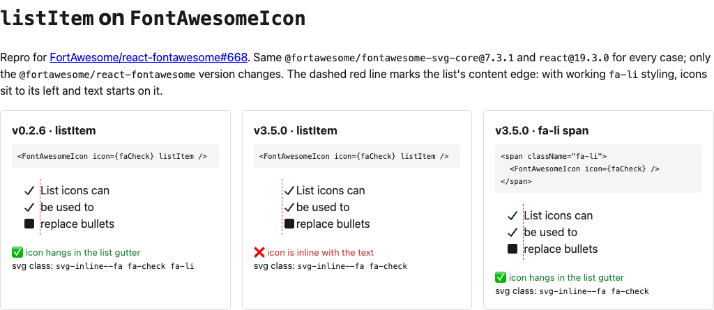

# react-fontawesome #668 repro: `listItem` no longer applies `fa-li`

Reproduction for [FortAwesome/react-fontawesome#668](https://github.com/FortAwesome/react-fontawesome/issues/668).

**Live demo:** https://kaelig.github.io/react-fontawesome-repro-668/



## What it shows

`<FontAwesomeIcon icon={faCheck} listItem />` inside a `<ul className="fa-ul">`, rendered with:

| Case | `react-fontawesome` | `<svg>` class | Icon position |
| --- | --- | --- | --- |
| `listItem` | 0.2.6 | `svg-inline--fa fa-check fa-li` | ✅ hangs in the list gutter |
| `listItem` | 3.5.0 (latest) | `svg-inline--fa fa-check` | ❌ inline, pushes the text right |
| `<span className="fa-li">` wrapper, no `listItem` | 3.5.0 (latest) | `svg-inline--fa fa-check` | ✅ hangs in the list gutter |

All three cases share the same `@fortawesome/fontawesome-svg-core@7.3.1` and `react@19`. v0.2.6 is installed alongside v3.5.0 through an npm alias (`react-fontawesome-0.2.6`), so only the React wrapper differs.

## Findings

- In 3.x, `listItem` is still accepted and still stripped from the DOM props, but it no longer maps to a class. `getClassListFromProps` doesn't read it.
- Its typings mark it `@deprecated` ("Simply wrap the icon instead, no need to pass this property"), but nothing warns at runtime and the 3.0.0 changelog doesn't mention it.
- Every 3.x release (3.0.0 through 3.5.0) behaves the same way. 0.2.6 maps `listItem` to `'fa-li'`.

## Run it

```sh
npm install
npm run dev     # side-by-side visual comparison with live DOM probes
npm run check   # headless: server-renders both versions, exits 1 if latest lacks fa-li
```

`npm run check` output with 3.5.0:

```
✅ react-fontawesome@0.2.6  listItem → class="svg-inline--fa fa-check fa-li "
❌ react-fontawesome@3.5.0  listItem → class="svg-inline--fa fa-check"
```

To test a fix, point `@fortawesome/react-fontawesome` at the patched build, then run `npm run check`.
